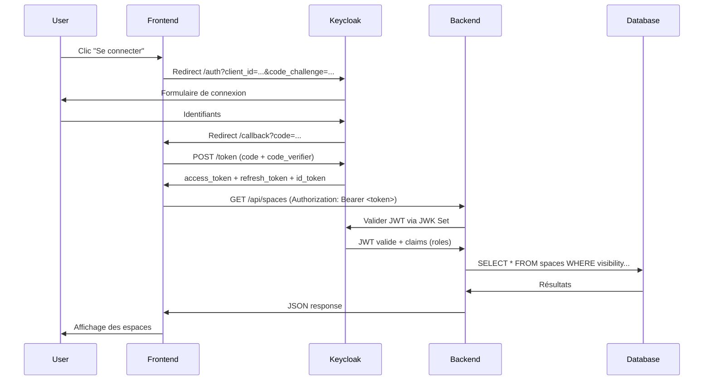

# Architecture Technique — Infovergne Home

Ce document décrit l'architecture technique détaillée du projet **Infovergne Home**.

---

## Vue d'ensemble

Infovergne Home est une application web full-stack composée de :

- **Frontend** : TanStack Start (React avec SSR)
- **Backend** : Spring Boot 4.1.1 (Java 25)
- **Base de données** : PostgreSQL 16 avec Liquibase
- **Authentification** : Keycloak (OAuth2/OpenID Connect)

---

## Architecture en couches

```
┌─────────────────────────────────────────────────────────────┐
│                         Frontend Layer                       │
│  TanStack Start · React 19 · Tailwind CSS · TypeScript      │
└─────────────────────────────────────────────────────────────┘
                              │
                         HTTP/REST
                              │
┌─────────────────────────────────────────────────────────────┐
│                       API Gateway Layer                      │
│                    Nginx (Reverse Proxy)                     │
│              SSL/TLS · Load Balancing · Caching             │
└─────────────────────────────────────────────────────────────┘
                              │
                              ├─────────────────┐
                              │                 │
┌─────────────────────────────▼────┐  ┌─────────▼──────────┐
│        Backend Layer             │  │   Security Layer   │
│  Spring Boot · REST Controllers  │  │     Keycloak       │
│  Services · Repositories         │  │   OAuth2 · JWT     │
└─────────────────────────────────┬┘  └────────────────────┘
                                  │
┌─────────────────────────────────▼────┐
│           Data Layer                 │
│        PostgreSQL 16                 │
│  JDBC · Transactions · Indexes       │
└──────────────────────────────────────┘
```

---

## Frontend — TanStack Start

### Technologies

- **Framework** : TanStack Start (React SSR)
- **UI** : Radix UI + Tailwind CSS 4
- **État** : TanStack Query (React Query)
- **Routage** : TanStack Router
- **Authentification** : Keycloak JS (PKCE)

### Structure

```
frontend/
├── src/
│   ├── routes/          # Pages et routes (file-based routing)
│   │   ├── __root.tsx   # Layout principal
│   │   ├── index.tsx    # Page d'accueil
│   │   ├── espaces/     # Gestion des espaces
│   │   ├── applications/# Catalogue d'applications
│   │   ├── admin.tsx    # Interface admin
│   │   └── api/         # API routes (SSR)
│   ├── components/      # Composants réutilisables
│   │   ├── ui/          # Composants Radix UI
│   │   ├── site-header.tsx
│   │   └── ...
│   ├── lib/             # Utilitaires et services
│   │   ├── keycloak.ts  # Client Keycloak
│   │   ├── db.server.ts # Accès DB (SSR)
│   │   └── queries.ts   # React Query hooks
│   └── styles.css       # Styles globaux
├── public/              # Assets statiques
└── vite.config.ts       # Configuration Vite
```

### Authentification Frontend

Le frontend utilise **Keycloak JS** avec le flux **Authorization Code + PKCE** :

1. **Connexion** : Redirection vers Keycloak
2. **Callback** : Récupération du code d'autorisation
3. **Exchange** : Échange code contre access_token + refresh_token
4. **Stockage** : Tokens stockés dans localStorage
5. **Refresh** : Renouvellement automatique avant expiration

```typescript
// src/lib/keycloak.ts
export async function login() {
  const verifier = randomString();
  sessionStorage.setItem('pkce-verifier', verifier);

  const params = new URLSearchParams({
    client_id: KEYCLOAK_CLIENT_ID,
    redirect_uri: `${window.location.origin}/auth/callback`,
    response_type: 'code',
    scope: 'openid profile email',
    code_challenge: await sha256(verifier),
    code_challenge_method: 'S256',
  });

  window.location.assign(`${KEYCLOAK_URL}/auth?${params}`);
}
```

---

## Backend — Spring Boot

### Technologies

- **Framework** : Spring Boot 4.1.1
- **Langage** : Java 25
- **Sécurité** : Spring Security + OAuth2 Resource Server
- **Base de données** : Spring Data JDBC (léger, sans JPA)
- **Migrations** : Liquibase (XML changesets)
- **Validation** : Bean Validation (Jakarta)

### Architecture en couches

```
┌─────────────────────────────────────────────────────────┐
│                    Controllers                          │
│  SpaceController · DocController · AppController        │
│  REST endpoints · Validation · Security annotations     │
└─────────────────────────────────────────────────────────┘
                            │
┌─────────────────────────────────────────────────────────┐
│                     Services                            │
│  SpaceService · DocService · AppService · AuditService  │
│  Business logic · Transactions · Access control         │
└─────────────────────────────────────────────────────────┘
                            │
┌─────────────────────────────────────────────────────────┐
│                   Repositories                          │
│  SpaceRepository · DocRepository · AppRepository        │
│  JDBC queries · Data mapping                            │
└─────────────────────────────────────────────────────────┘
                            │
┌─────────────────────────────────────────────────────────┐
│                    PostgreSQL                           │
└─────────────────────────────────────────────────────────┘
```

### Configuration Security

```java
// SecurityConfig.java
@Configuration
@EnableWebSecurity
@EnableMethodSecurity
public class SecurityConfig {

    @Bean
    public SecurityFilterChain securityFilterChain(HttpSecurity http) {
        http
            .cors(cors -> cors.configurationSource(corsConfigurationSource()))
            .csrf(csrf -> csrf.disable())
            .sessionManagement(session ->
                session.sessionCreationPolicy(SessionCreationPolicy.STATELESS))
            .authorizeHttpRequests(auth -> auth
                .requestMatchers("/actuator/health", "/api/public/**").permitAll()
                .requestMatchers("/api/**").authenticated()
                .anyRequest().authenticated()
            )
            .oauth2ResourceServer(oauth2 -> oauth2
                .jwt(jwt -> jwt.jwtAuthenticationConverter(jwtAuthenticationConverter()))
            );
        return http.build();
    }

    @Bean
    public JwtAuthenticationConverter jwtAuthenticationConverter() {
        JwtAuthenticationConverter converter = new JwtAuthenticationConverter();

        converter.setJwtGrantedAuthoritiesConverter(jwt -> {
            // Extraire les rôles Keycloak
            var realmRoles = extractRealmRoles(jwt);
            var clientRoles = extractClientRoles(jwt);

            return Stream.concat(realmRoles.stream(), clientRoles.stream())
                .map(role -> "ROLE_" + role.toUpperCase())
                .map(SimpleGrantedAuthority::new)
                .toList();
        });

        return converter;
    }
}
```

### Endpoints API

| Endpoint                       | Méthode | Description               | Auth   |
| ------------------------------ | ------- | ------------------------- | ------ |
| `/api/spaces`                  | GET     | Liste des espaces         | User   |
| `/api/spaces`                  | POST    | Créer un espace           | Admin  |
| `/api/spaces/{slug}`           | GET     | Détails d'un espace       | User   |
| `/api/spaces/{slug}`           | PUT     | Modifier un espace        | Admin  |
| `/api/spaces/{slug}`           | DELETE  | Supprimer un espace       | Admin  |
| `/api/docs`                    | GET     | Liste des documents       | User   |
| `/api/docs`                    | POST    | Créer un document         | Editor |
| `/api/docs/{spaceSlug}/{slug}` | GET     | Détails d'un document     | User   |
| `/api/docs/{spaceSlug}/{slug}` | PUT     | Modifier un document      | Editor |
| `/api/docs/{spaceSlug}/{slug}` | DELETE  | Supprimer un document     | Admin  |
| `/api/docs/search?q=...`       | GET     | Recherche full-text       | User   |
| `/api/apps`                    | GET     | Liste des applications    | User   |
| `/api/apps`                    | POST    | Ajouter une application   | Admin  |
| `/api/apps/{slug}`             | GET     | Détails d'une application | User   |
| `/api/apps/{slug}/state`       | PUT     | Mettre à jour l'état      | Admin  |
| `/actuator/health`             | GET     | Healthcheck               | Public |

### Audit Logging

Toutes les actions d'administration sont tracées dans `audit_logs` :

```java
@Service
public class AuditService {

    public void log(String userId, String action, String entityType,
                    String entityId, Map<String, Object> changes) {
        jdbcTemplate.update("""
            INSERT INTO audit_logs (user_id, action, entity_type, entity_id, changes)
            VALUES (?, ?, ?, ?, ?::jsonb)
            """,
            userId, action, entityType, entityId, toJson(changes)
        );
    }
}
```

---

## Migrations de base de données — Liquibase

### Vue d'ensemble

Le projet utilise **Liquibase** pour gérer les migrations de base de données de manière versionnée et contrôlée.

### Structure des changesets

```
backend/src/main/resources/db/changelog/
├── db.changelog-master.yaml      # Fichier master (orchestration)
└── changes/
    ├── 001-initial-schema.xml    # Schéma initial (tables, contraintes, indexes)
    └── 002-initial-data.xml      # Données initiales (site_settings)
```

### Configuration

```yaml
# application.yml
spring:
  liquibase:
    change-log: classpath:db/changelog/db.changelog-master.yaml
    enabled: true
```

### Changeset Master (YAML)

```yaml
# db.changelog-master.yaml
databaseChangeLog:
  - include:
      file: db/changelog/changes/001-initial-schema.xml
  - include:
      file: db/changelog/changes/002-initial-data.xml
```

### Exemple de changeset (XML)

```xml
<!-- 001-initial-schema.xml -->
<?xml version="1.0" encoding="UTF-8"?>
<databaseChangeLog
    xmlns="http://www.liquibase.org/xml/ns/dbchangelog"
    xmlns:xsi="http://www.w3.org/2001/XMLSchema-instance"
    xsi:schemaLocation="http://www.liquibase.org/xml/ns/dbchangelog
    http://www.liquibase.org/xml/ns/dbchangelog/dbchangelog-4.20.xsd">

    <changeSet id="001-enable-extensions" author="system">
        <sql>
            CREATE EXTENSION IF NOT EXISTS pg_trgm;
        </sql>
    </changeSet>

    <changeSet id="002-create-spaces-table" author="system">
        <createTable tableName="spaces">
            <column name="id" type="text">
                <constraints primaryKey="true"/>
            </column>
            <column name="slug" type="text">
                <constraints nullable="false" unique="true"/>
            </column>
            <!-- ... autres colonnes -->
        </createTable>
        <addCheckConstraint tableName="spaces"
            constraintName="spaces_type_check"
            checkCondition="type IN ('wiki', 'blog')"/>
    </changeSet>
</databaseChangeLog>
```

### Avantages de Liquibase

- ✅ **Versioning** : Chaque changement est tracé dans `DATABASECHANGELOG`
- ✅ **Rollback** : Possibilité d'annuler des migrations
- ✅ **Idempotence** : Exécution safe même si déjà appliqué
- ✅ **Multi-environnement** : Dev, test, prod avec le même processus
- ✅ **Audit** : Historique complet des modifications de schéma

### Tables Liquibase

Liquibase crée automatiquement deux tables :

```sql
-- Historique des changesets appliqués
CREATE TABLE DATABASECHANGELOG (
  ID VARCHAR(255) NOT NULL,
  AUTHOR VARCHAR(255) NOT NULL,
  FILENAME VARCHAR(255) NOT NULL,
  DATEEXECUTED TIMESTAMP NOT NULL,
  ORDEREXECUTED INT NOT NULL,
  EXECTYPE VARCHAR(10) NOT NULL,
  MD5SUM VARCHAR(35),
  DESCRIPTION VARCHAR(255),
  COMMENTS VARCHAR(255),
  TAG VARCHAR(255),
  LIQUIBASE VARCHAR(20),
  CONTEXTS VARCHAR(255),
  LABELS VARCHAR(255),
  DEPLOYMENT_ID VARCHAR(10)
);

-- Lock pour éviter les migrations concurrentes
CREATE TABLE DATABASECHANGELOGLOCK (
  ID INT NOT NULL,
  LOCKED BOOLEAN NOT NULL,
  LOCKGRANTED TIMESTAMP,
  LOCKEDBY VARCHAR(255),
  CONSTRAINT PK_DATABASECHANGELOGLOCK PRIMARY KEY (ID)
);
```

### Commandes utiles

```bash
# Afficher le statut des migrations
mvn liquibase:status

# Appliquer les migrations en attente
mvn liquibase:update

# Générer un script SQL des changements
mvn liquibase:updateSQL

# Rollback du dernier changeset
mvn liquibase:rollback -Dliquibase.rollbackCount=1

# Créer un tag pour un point de rollback
mvn liquibase:tag -Dliquibase.tag=v1.0.0
```

### Bonnes pratiques

1. **Ne jamais modifier un changeset déjà appliqué** → Créer un nouveau changeset
2. **Utiliser des IDs descriptifs** : `001-create-users-table` plutôt que `change1`
3. **Tester les rollbacks** avant déploiement production
4. **Séparer schéma et données** : fichiers distincts pour structure et data
5. **Versionner avec le code** : changesets dans le repository Git

---

## Base de données — PostgreSQL

### Schéma

```sql
-- Espaces (wiki/blog)
CREATE TABLE spaces (
  id TEXT PRIMARY KEY,
  slug TEXT UNIQUE NOT NULL,
  name TEXT NOT NULL,
  type TEXT NOT NULL CHECK (type IN ('wiki', 'blog')),
  visibility TEXT NOT NULL DEFAULT 'public',
  allowed_roles TEXT[],
  write_roles TEXT[],
  position INTEGER DEFAULT 1
);

-- Documents (pages wiki ou articles blog)
CREATE TABLE docs (
  id TEXT PRIMARY KEY,
  space_slug TEXT NOT NULL REFERENCES spaces(slug) ON UPDATE CASCADE ON DELETE CASCADE,
  slug TEXT NOT NULL,
  title TEXT NOT NULL,
  body TEXT NOT NULL,
  tags TEXT[],
  status TEXT NOT NULL DEFAULT 'draft',
  visibility TEXT NOT NULL DEFAULT 'public',
  allowed_roles TEXT[],
  author TEXT NOT NULL,
  published_at TIMESTAMPTZ NOT NULL DEFAULT NOW(),
  updated_at TIMESTAMPTZ NOT NULL DEFAULT NOW(),
  UNIQUE (space_slug, slug)
);

-- Applications Docker
CREATE TABLE apps (
  id TEXT PRIMARY KEY,
  slug TEXT UNIQUE NOT NULL,
  name TEXT NOT NULL,
  url TEXT NOT NULL,
  category TEXT NOT NULL,
  visibility TEXT NOT NULL DEFAULT 'public',
  allowed_roles TEXT[],
  state TEXT NOT NULL DEFAULT 'unknown',
  state_at TIMESTAMPTZ NOT NULL DEFAULT NOW()
);

-- Audit logs (traçabilité)
CREATE TABLE audit_logs (
  id UUID PRIMARY KEY DEFAULT gen_random_uuid(),
  user_id TEXT NOT NULL,
  action TEXT NOT NULL,
  entity_type TEXT NOT NULL,
  entity_id TEXT NOT NULL,
  changes JSONB,
  created_at TIMESTAMPTZ NOT NULL DEFAULT NOW()
);
```

### Indexes de performance

```sql
-- Full-text search sur documents
CREATE INDEX docs_fts ON docs USING gin (
  to_tsvector('french', coalesce(title, '') || ' ' || coalesce(body, ''))
);

-- Trigram search (recherche floue)
CREATE INDEX docs_title_trgm ON docs USING gin (title gin_trgm_ops);
CREATE INDEX docs_body_trgm ON docs USING gin (body gin_trgm_ops);

-- Recherche par tags
CREATE INDEX docs_tags ON docs USING gin(tags);
CREATE INDEX apps_tags ON apps USING gin(tags);

-- Filtres fréquents
CREATE INDEX docs_space_status ON docs(space_slug, status, published_at DESC);
CREATE INDEX spaces_visibility ON spaces(visibility, position);

-- Audit logs
CREATE INDEX audit_user ON audit_logs(user_id);
CREATE INDEX audit_entity ON audit_logs(entity_type, entity_id);
CREATE INDEX audit_created ON audit_logs(created_at DESC);
```

---

## Authentification — Keycloak

### Flux OAuth2/OpenID Connect



### Structure du JWT

```json
{
  "exp": 1735123456,
  "iat": 1735120000,
  "jti": "uuid",
  "iss": "http://keycloak.local:8083/realms/infovergne",
  "sub": "user-uuid",
  "typ": "Bearer",
  "azp": "infovergne-home",
  "realm_access": {
    "roles": ["ADMIN", "USER"]
  },
  "resource_access": {
    "infovergne-home": {
      "roles": ["INFOVERGNE_ADMIN"]
    }
  },
  "scope": "openid profile email",
  "email_verified": true,
  "name": "John Doe",
  "preferred_username": "john.doe",
  "given_name": "John",
  "family_name": "Doe",
  "email": "john.doe@example.com"
}
```

### Extraction des rôles

Le backend extrait les rôles depuis :

1. **realm_access.roles** : Rôles au niveau du realm
2. **resource_access.{client_id}.roles** : Rôles spécifiques au client

Les rôles sont préfixés par `ROLE_` et convertis en majuscules :

```
ADMIN → ROLE_ADMIN
homelab_admin → ROLE_HOMELAB_ADMIN
```

---

## Contrôle d'accès

### Visibilité des ressources

Chaque ressource (space, doc, app) a :

- **visibility** : `public` ou `restricted`
- **allowed_roles** : Liste des rôles autorisés (si `restricted`)

```java
private boolean isAccessible(Space space, List<String> userRoles) {
    if ("public".equals(space.getVisibility())) {
        return true;
    }

    if (space.getAllowedRoles() == null || space.getAllowedRoles().isEmpty()) {
        return true;
    }

    return userRoles.stream()
        .anyMatch(role -> space.getAllowedRoles().contains(role.toUpperCase()));
}
```

### Annotations de sécurité

```java
@RestController
@RequestMapping("/api/spaces")
public class SpaceController {

    // Accessible par tous les utilisateurs authentifiés
    @GetMapping
    public List<Space> listSpaces(@AuthenticationPrincipal Jwt jwt) {
        // ...
    }

    // Accessible uniquement par les admins
    @PostMapping
    @PreAuthorize("hasAnyRole('ADMIN', 'HOMELAB_ADMIN')")
    public Space createSpace(@RequestBody Space space) {
        // ...
    }
}
```

---

## Performance et scalabilité

### Caching

- **Frontend** : TanStack Query avec stale-while-revalidate
- **Backend** : Spring Cache sur les ressources publiques
- **Nginx** : Cache statique pour assets (images, CSS, JS)

### Connection pooling

```yaml
spring:
  datasource:
    hikari:
      maximum-pool-size: 10
      minimum-idle: 2
      connection-timeout: 30000
      idle-timeout: 600000
      max-lifetime: 1800000
```

### Indexes de base de données

- **Full-text search** : Gin indexes sur `to_tsvector`
- **Trigram** : Recherche floue sur titres et contenus
- **Array** : Gin indexes sur les colonnes `tags`

---

## Monitoring et observabilité

### Healthchecks

- **Backend** : `/actuator/health`
- **Frontend** : Port HTTP 3000
- **PostgreSQL** : `pg_isready`

### Métriques

Spring Boot Actuator expose :

- `/actuator/metrics` : Métriques JVM, HTTP, DB
- `/actuator/info` : Informations de build
- `/actuator/env` : Variables d'environnement (production : restreint)

### Logs

- **Format** : JSON structuré (logback)
- **Niveaux** : INFO (production), DEBUG (développement)
- **Destinations** : stdout (capturé par Docker)

---

## Sécurité

### Protections

- **HTTPS** : Obligatoire en production (via Nginx)
- **CORS** : Configuré strictement dans Spring Security
- **CSRF** : Désactivé (API REST stateless avec JWT)
- **XSS** : Sanitization HTML côté frontend
- **SQL Injection** : Requêtes préparées (JDBC)

### Secrets

- **Tokens Keycloak** : Jamais stockés côté serveur
- **Passwords DB** : Variables d'environnement uniquement
- **Certificats SSL** : Permissions restrictives (600)

---

## Diagrammes

### Déploiement en production

```
                    Internet
                        │
                        │
┌───────────────────────▼──────────────────────┐
│               Load Balancer                  │
│            (Nginx / Traefik)                 │
│         SSL Termination · HTTP/2             │
└──────────────────┬───────────────────────────┘
                   │
      ┌────────────┴──────────────┐
      │                           │
┌─────▼─────┐            ┌────────▼────────┐
│ Frontend  │            │    Backend      │
│ Container │◄───────────│   Container     │
│  (Node)   │    API     │  (Java 21)      │
└───────────┘            └────────┬────────┘
                                  │
                         ┌────────▼────────┐
                         │   PostgreSQL    │
                         │   Container     │
                         └─────────────────┘
                                  │
                         ┌────────▼────────┐
                         │   Keycloak      │
                         │  (Externe)      │
                         └─────────────────┘
```

### Flux de données

```
User Request
    ↓
Nginx (SSL + routing)
    ↓
Frontend (SSR ou SPA)
    ↓
Backend API (JWT validation)
    ↓
PostgreSQL (data access)
    ↓
Response (JSON)
```

---

## Technologies tierces

| Bibliothèque    | Version | Usage                         |
| --------------- | ------- | ----------------------------- |
| Spring Boot     | 4.1.1   | Framework backend             |
| Java            | 25      | Langage backend               |
| PostgreSQL      | 16      | Base de données               |
| Liquibase       | 4.20+   | Migrations de base de données |
| React           | 19      | UI frontend                   |
| TanStack Router | 1.x     | Routage frontend              |
| TanStack Query  | 5.x     | État client                   |
| Keycloak        | 23+     | Authentification              |
| Lombok          | 1.18.42 | Réduction boilerplate Java    |
| Tailwind CSS    | 4.x     | Styles frontend               |
| Radix UI        | Latest  | Composants accessibles        |

---

## Conventions de code

### Backend (Java)

- **Package naming** : `com.homelab.showcase.{layer}`
- **Classe Service** : Suffixe `Service` (ex: `SpaceService`)
- **Classe Controller** : Suffixe `Controller` (ex: `SpaceController`)
- **Classe Repository** : Suffixe `Repository` (ex: `SpaceRepository`)
- **Style** : Google Java Style Guide

### Frontend (TypeScript)

- **Composants** : PascalCase (ex: `SiteHeader.tsx`)
- **Hooks** : Préfixe `use` (ex: `useAuth.ts`)
- **Utils** : camelCase (ex: `formatDate.ts`)
- **Style** : Prettier + ESLint

---

## Roadmap technique

### Phase 1 (actuelle) ✅

- Backend Spring Boot avec OAuth2
- Frontend TanStack Start
- PostgreSQL avec full-text search
- Déploiement Docker Compose

### Phase 2 (future)

- [ ] Cache Redis pour sessions
- [ ] Elasticsearch pour recherche avancée
- [ ] API GraphQL en complément du REST
- [ ] WebSocket pour notifications temps réel
- [ ] Tests E2E avec Playwright

### Phase 3 (future)

- [ ] Kubernetes déploiement
- [ ] CI/CD GitHub Actions
- [ ] Monitoring Prometheus + Grafana
- [ ] Logs centralisés (Loki)
- [ ] Clustering PostgreSQL

---

## Ressources

- [Spring Boot Documentation](https://docs.spring.io/spring-boot/docs/current/reference/htmlsingle/)
- [TanStack Start](https://tanstack.com/start)
- [Keycloak Documentation](https://www.keycloak.org/documentation)
- [PostgreSQL Documentation](https://www.postgresql.org/docs/)
